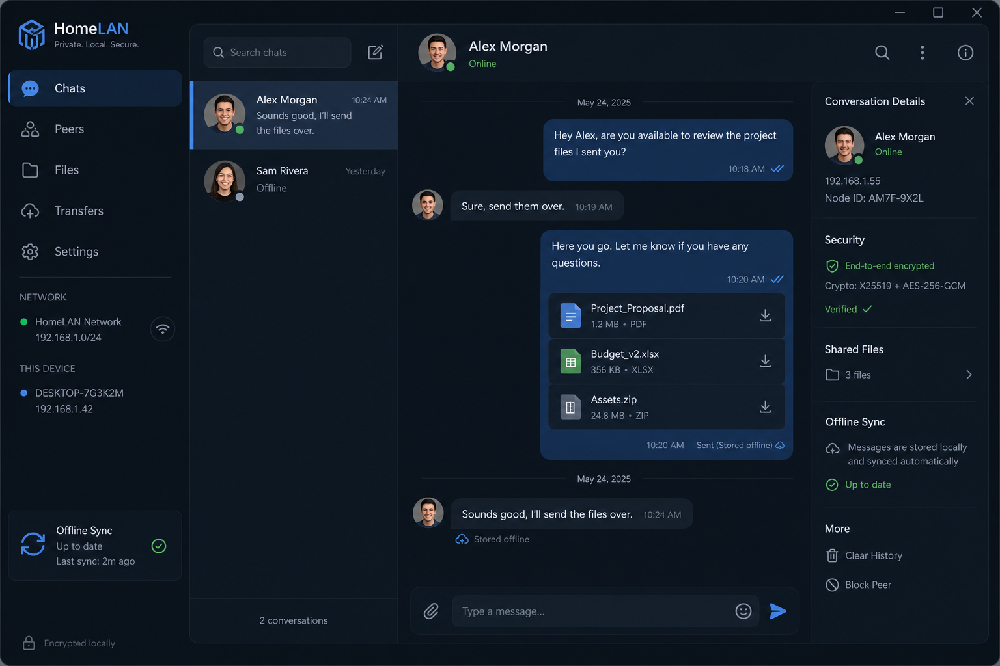

# 🏠 HomeLAN Messenger 1.0

Приватный мессенджер для домашней сети: два человека, их телефоны и компьютеры,
свой сервер на Orange Pi — без интернета, облаков и телеметрии.



## Что внутри

* **Сквозное шифрование**: X25519 + HKDF-SHA256 + XChaCha20-Poly1305. Сервер хранит
  только шифротексты и отвергает незашифрованные сообщения.
* **Один ключ на человека**, перенос на новые устройства через 2 QR-кода (или
  текст, если нет камеры). Ключ передаётся зашифрованным, сервер его не видит.
* **Сверка отпечатков** против подмены ключей; смена ключа собеседника блокирует
  отправку до проверки.
* **Синхронизация без потерь**: курсор изменений (включая удаления и статусы),
  outbox с идемпотентной повторной отправкой.
* **Файлы до 2 ГБ**: потоковое шифрование и загрузка, без загрузки в память.
* **Сервер**: SQLCipher, ключ на USB-флешке; вайп при извлечении флешки,
  duress-пароль, Dead Man's Switch; вайп уничтожает и ключ на флешке.
* **Клиент**: биометрия/PIN, защита от скриншотов, без облачных бэкапов.

## Структура

```
homelan-server/   сервер (Go): cmd/server, internal/{server,db,ws,linking,panic,usb,ratelimit,mdns,config}
client/           клиент (Flutter): lib/{services,providers,screens,widgets,models}
docs/             ARCHITECTURE.md, THREAT_MODEL.md, DEPLOYMENT.md
```

## Быстрый старт

```bash
cd homelan-server
go build -o homelan-server ./cmd/server
./homelan-server --init-usb   # один раз: ключ на флешку
./homelan-server
```

Клиенты: `cd client && flutter build apk --release` / `flutter build windows --release`.
Подробно — в [docs/DEPLOYMENT.md](docs/DEPLOYMENT.md).

## Важно знать

Прочитайте [docs/THREAT_MODEL.md](docs/THREAT_MODEL.md). Коротко: нет Perfect
Forward Secrecy; вход и метаданные идут по HTTP внутри LAN; если сервер изъяли
вместе со вставленной флешкой и просто выключили питание — данные можно
расшифровать.

## Лицензия

© 2026 HomeLAN Authors. Все права защищены. Исходный код доступен для личного
домашнего использования и ознакомления; коммерческое использование и
распространение изменённых версий — только с согласия правообладателя.
